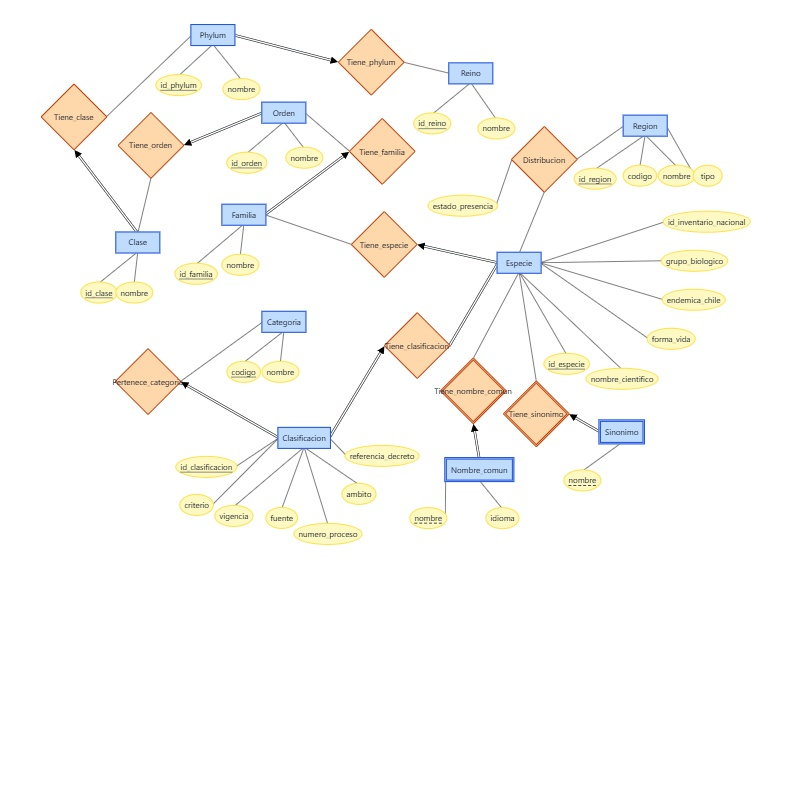
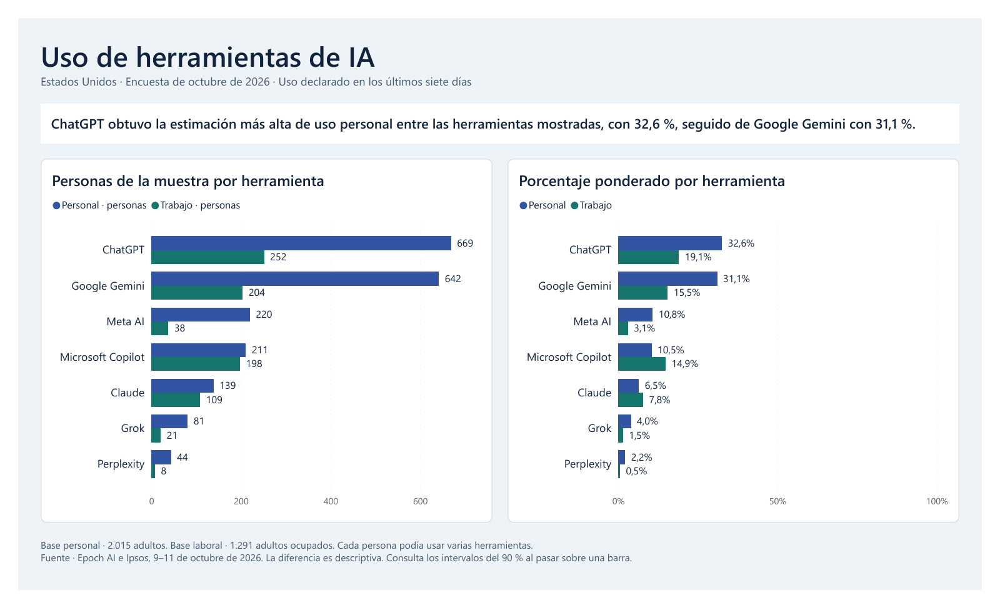
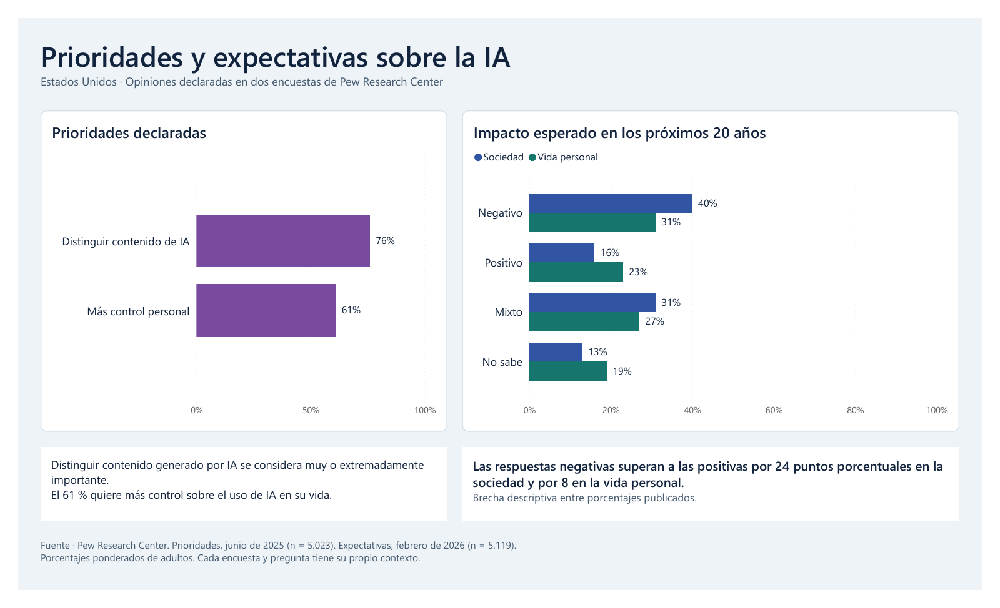
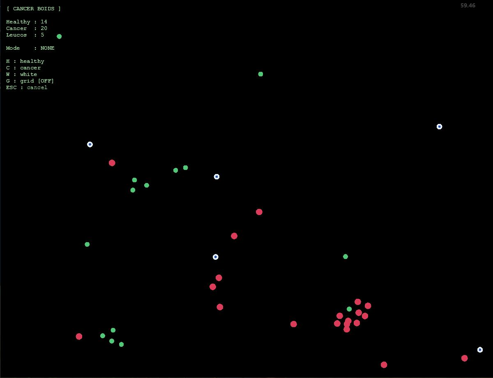
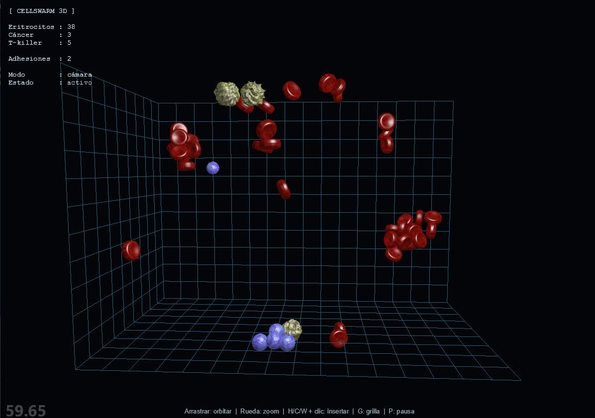

<div align="center">

<h1>Proyectos</h1>

<h3>Biodiversidad de Chile, análisis de encuestas y simulación computacional</h3>


<p>
  FurFan reúne una base de datos relacional y una aplicación web para explorar la biodiversidad de Chile. El portafolio también incluye un informe en Power BI sobre el uso de IA y Cells'War, una simulación de poblaciones celulares.
</p>

</div>

---

## Contenido

- [Biodiversidad de Chile](#bases-de-datos-biodiversidad-de-chile)
  - [Mi aporte](#mi-aporte)
  - [Consultas de la aplicación](#consultas-de-la-aplicación)
- [Power BI: Uso, prioridades y expectativas sobre la IA](#power-bi-uso-prioridades-y-expectativas-sobre-la-ia)
- [Cells'War](#cellswar)
- [Sistema de turnos en Scala](#sistema-de-turnos-en-scala)

## Bases de datos: Biodiversidad de Chile

**FurFan · Proyecto académico grupal de Bases de Datos (CC3201)**

El proyecto organiza información sobre especies presentes en Chile. El modelo relaciona especies con sus nombres comunes y sinónimos, su distribución regional y sus clasificaciones de conservación actuales e históricas. También representa la jerarquía taxonómica desde reino hasta especie. [Explorar FurFan Web](https://grupo36.cc3201.dcc.uchile.cl/).

### Mi aporte

- **Modelo relacional.** Diseñé el esquema relacional a partir del modelo entidad-relación. Definí las tablas y sus claves, incluidas las relaciones que vinculan especies con regiones y conectan los niveles de la jerarquía taxonómica. Revisé la normalización del esquema con la forma normal de Boyce-Codd (FNBC).
- **Implementación web y consultas.** Desarrollé FurFan Web con ayuda de Codex, un asistente de programación con IA. Implementé la interfaz con HTML, CSS y JavaScript y la conecté a PostgreSQL mediante una API en PHP con PDO. Integré consultas SQL parametrizadas y agregué filtros y paginación a la búsqueda de especies.

### Consultas de la aplicación

1. **Búsqueda de especies.** Busca por nombre científico, nombre común o sinónimo. Permite filtrar por región, grupo biológico y categoría de conservación.
2. **Endemismo por región.** Compara la cantidad y el porcentaje de especies endémicas por grupo biológico dentro de una región. Permite indicar un mínimo de especies endémicas.
3. **Clasificación taxonómica.** A partir del nombre científico exacto, muestra el reino, filo, clase, orden y familia de la especie, junto con el número de especies registradas en esa familia.

### Modelo entidad-relación



---

## Power BI: Uso, prioridades y expectativas sobre la IA

Informe de Power BI sobre el uso de IA entre adultos de Estados Unidos. La primera página compara el uso personal y laboral de siete herramientas con datos de Epoch AI e Ipsos. La segunda reúne prioridades y expectativas a partir de dos encuestas de Pew Research Center. Los scripts de Python y pandas reproducen las tablas de resultados.

El gráfico de uso muestra porcentajes ponderados. Pasa el puntero sobre una barra para consultar los intervalos de confianza del 90 %.

Para explorar el informe, clona o descarga el repositorio y abre `PowerBL/Uso de IA.pbip` en Power BI Desktop. [Guía para abrir el informe y reproducir los datos](PowerBL/LEEME.md)





---

## Cells'War




**Cells'War** es una simulación semi-realista de las interacciones entre tres
poblaciones celulares:

- células normales;
- células blancas;
- células cancerígenas.

El proyecto incluye dos variantes, **Cells2D** y **Cells3D**. Ambas comparten el
mismo planteamiento general, pero emplean herramientas y enfoques de
representación diferentes.

La geometría de ambas variantes se dibuja con **ModernGL**. La versión 2D agrupa círculos y segmentos en buffers reutilizables; la versión 3D utiliza mallas, texturas y shaders. Pyglet se encarga de la ventana, los controles y el texto del panel.

### Características principales

- Visualización de la distribución espacial en 2D mediante una **grilla de densidad** y grilla de referencia en 3D.
- Uso de un **KD-Tree** para acelerar las consultas de proximidad.
- Modificación de las poblaciones celulares en tiempo real.
- Posibilidad de probar diferentes cantidades iniciales de cada tipo de célula.
- Propagación del cáncer por conversión de células sanas y eliminación de células cancerígenas por las células defensivas.

### Consideraciones técnicas

1. El espacio de simulación es intencionalmente acotado para favorecer las
   consultas espaciales y el comportamiento del KD-Tree.
2. El modelo no incorpora regeneración de células sanas. La población cancerígena puede crecer por conversión y disminuir por acción defensiva.
3. Cada población celular se representa mediante una versión generalizada de
   su comportamiento.
4. El modelo prioriza la experimentación visual y computacional por sobre la
   precisión biomédica.

### Requisitos

```text
numpy>=1.26
scipy>=1.12
pyglet>=2.1,<3
moderngl>=5.10,<6
pillow>=10
```

Para ejecutar la versión 2D desde la carpeta del repositorio:

```powershell
py -m pip install -r requirements.txt
py .\Cellswar2D.py
```

Mantén `render_moderngl.py` junto al archivo de la simulación: contiene el dibujo de las primitivas 2D. La versión 3D está en [cellswar3D.rar](cellswar3D.rar), con sus texturas, requisitos e instrucciones.

ModernGL administra el renderizado sobre un contexto **OpenGL 3.3 o superior**. La geometría se dibuja con shaders y buffers de ModernGL; sigue siendo necesario el soporte del controlador gráfico. [Contextos de ModernGL](https://moderngl.readthedocs.io/en/latest/reference/context.html).

---

## Sistema de turnos en Scala

Proyecto académico en Scala 3 que modela un combate por turnos. Incluye un controlador de acciones, un planificador por barras de acción y pruebas con MUnit. [Ver carpeta ProyectoScala](ProyectoScala/) · [Requisitos y pruebas](ProyectoScala/README.md#requisitos-y-pruebas)

---

<div align="center">

Bases de datos, desarrollo web, análisis de encuestas y simulación computacional.

</div>
