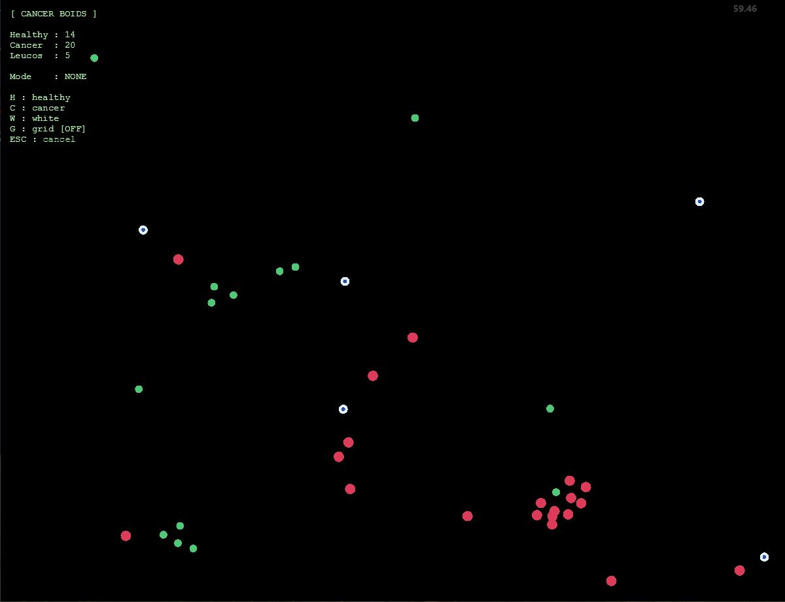
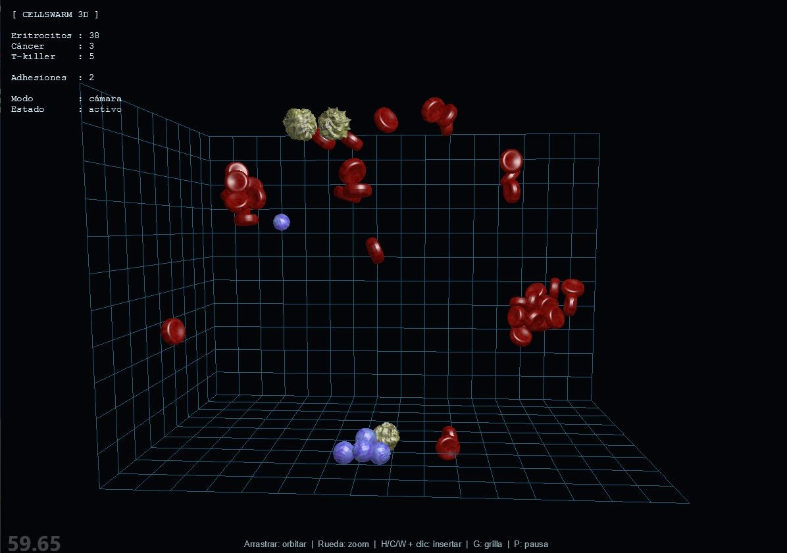
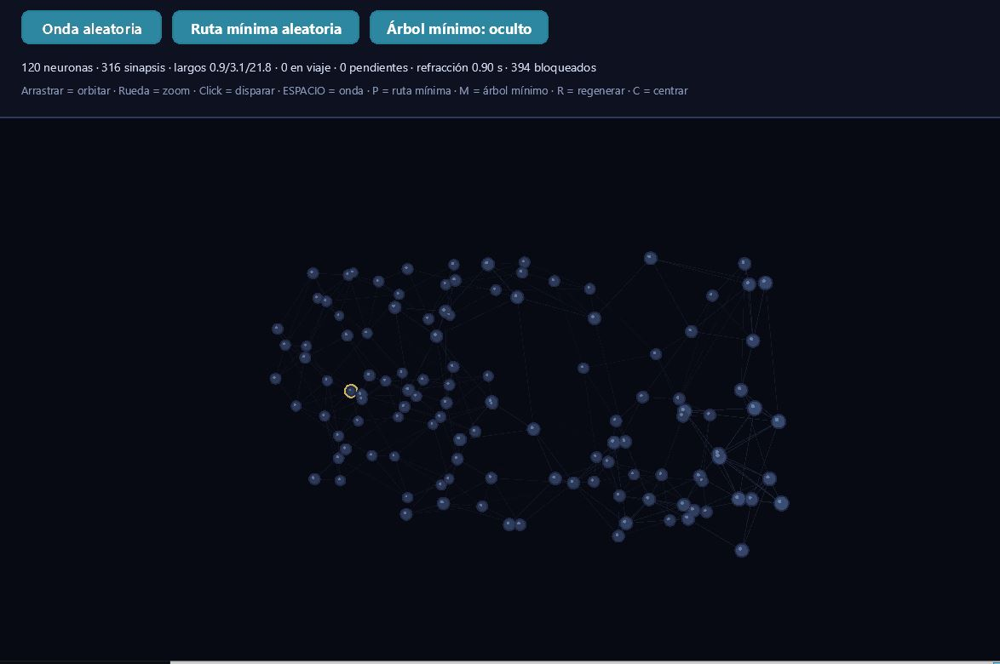
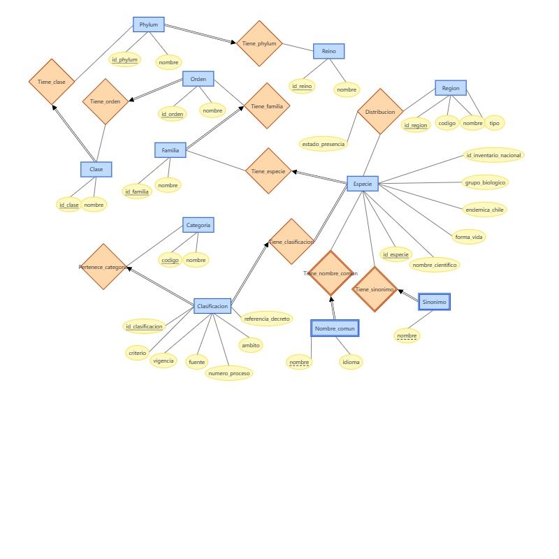

<div align="center">

<h1>Proyectos</h1>

<h3>Simulaciones gráficas, bases de datos y proyectos escalables</h3>


<p>
  Proyectos e ideas para explorar temas de biología, computación gráfica, teoría de grafos, bases de datos y programación orientada a objetos.
</p>

</div>

---

## Contenido

- [Descripción general](#descripción-general)
- [Cells'War](#cellswar)
- [Redes de impulsos nerviosos](#redes-de-impulsos-nerviosos)
- [Biodiversidad de Chile](#bases-de-datos-biodiversidad-de-chile)
- [Sistema de turnos en Scala](#poo-sistema-de-turnos-en-scala)
- [Alcance de los modelos](#alcance-de-los-modelos)


## Descripción general

| Proyecto | Objetivo principal | Tecnologías y conceptos principales |
| --- | --- | --- |
| **Cells'War** | Representar la interacción entre células normales, células blancas y células cancerígenas. | NumPy, SciPy, Pyglet, ModernGL y KD-Tree |
| **Redes de impulsos nerviosos** | Explorar la propagación de impulsos en una red de neuronas representada como un grafo en 3D. | Python, Pyglet, Dijkstra y Prim |
| **Biodiversidad de Chile** | Modelar información sobre especies, regiones y clasificaciones de conservación. | Modelo entidad-relación, modelo relacional y FNBC |
| **Scala y POO** | Modelar un combate por turnos e integrar sus acciones y el control de turnos. | Scala 3, POO, Visitor, sbt y MUnit |

> [!NOTE]
> Las simulaciones son modelos visuales simplificados. Su propósito es explorar
> técnicas de simulación y computación gráfica, no reproducir con exactitud un
> sistema biológico o físico real.

---

## Cells'War




**Cells'War** es una simulación semi-realista de las interacciones entre tres
poblaciones celulares:

- células normales;
- células blancas;
- células cancerígenas.

El proyecto incluye dos variantes, **Cells2D** y **Cells3D**. Ambas comparten el
mismo planteamiento general, pero emplean herramientas y enfoques de
representación diferentes.

### Características principales

- Visualización de la distribución espacial mediante un **mapa de calor**.
- Uso de un **KD-Tree** para acelerar las consultas de proximidad.
- Modificación de las poblaciones celulares en tiempo real.
- Posibilidad de probar diferentes cantidades iniciales de cada tipo de célula.
- Propagación del cáncer mediante un crecimiento acumulativo: una célula
  infectada muta y puede infectar nuevos objetivos.

### Consideraciones técnicas

1. El espacio de simulación es intencionalmente acotado para favorecer las
   consultas espaciales y el comportamiento del KD-Tree.
2. El modelo de infección no incorpora regeneración ni decaimiento de la
   población cancerígena.
3. Cada población celular se representa mediante una versión generalizada de
   su comportamiento.
4. El modelo prioriza la experimentación visual y computacional por sobre la
   precisión biomédica.

### Requisitos

```text
numpy>=1.26
scipy>=1.12
pyglet>=2.1
moderngl>=5.10
pillow>=10.0
```

---

## Redes de impulsos nerviosos



La idea es utilizar las propiedades de los grafos para representar una red de neuronas y observar cómo se propaga un impulso entre ellas. Los vértices representan las neuronas y las aristas sus conexiones. La vista 3D permite recorrer la red y comparar la propagación con una ruta mínima o un árbol de costo mínimo.

### Características principales

- Parte con **120 neuronas** distribuidas en el espacio, con conexiones cercanas y algunos enlaces largos.
- Cada neurona pasa por reposo, disparo y un período refractario que limita las activaciones seguidas.
- Para evitar loops de propagación, cada onda puede activar una sola vez a cada neurona, aunque encuentre otro camino para regresar.
- Utiliza **Dijkstra** para calcular la ruta con menor suma de distancias entre dos neuronas. El impulso de esa ruta no se bifurca.
- Utiliza **Prim** para construir el árbol que conecta la distribución inicial y para calcular el árbol de costo mínimo de la red final. Al mostrarlo, las demás conexiones siguen transmitiendo pulsos.
- Separa la lógica del grafo de la visualización, lo que permite comprobar el modelo sin abrir una ventana.

### Controles

| Control | Acción |
| :---: | --- |
| Clic izquierdo sobre una neurona | Inicia un pulso si está en reposo. |
| Arrastrar con el botón izquierdo | Gira la cámara alrededor de la red. |
| Rueda del mouse | Acerca o aleja la cámara. |
| `Espacio` | Intenta iniciar una onda desde una neurona aleatoria. |
| `P` | Calcula una ruta mínima entre dos neuronas aleatorias e intenta enviar un impulso por ella. |
| `M` | Muestra u oculta el árbol de costo mínimo. |
| `R` | Genera otra red y borra la actividad anterior. |
| `C` | Restablece la orientación y centra la cámara. |
| `Esc` | Cierra la simulación. |

### Requisitos

- Python; esta versión se probó con **Python 3.11.4** en Windows.
- **Pyglet 2.1**, la única dependencia externa de esta simulación.
- Soporte gráfico para **OpenGL 3.3 o superior**.

El archivo `requirements.txt` del comprimido especifica `pyglet>=2.1,<3`.

### Cómo ejecutarlo

La versión actualizada está en [Redes_complejas.zip](Redes_complejas.zip). Desde la carpeta del repositorio, ejecuta lo siguiente en PowerShell:

```powershell
Expand-Archive -LiteralPath .\Redes_complejas.zip -DestinationPath .\Redes_complejas -Force
Set-Location .\Redes_complejas\3D_neuronas
py -m pip install -r requirements.txt
py .\simulacion_red_neuronal_3d.py
```

Dentro de `3D_neuronas` se incluyen la explicación del modelo, los parámetros para experimentar y las pruebas del núcleo. Para ejecutar esas pruebas desde la misma carpeta:

```powershell
py -m unittest discover -s tests -v
```

---

## Bases de datos: Biodiversidad de Chile

**Proyecto académico grupal**  

Diseño de una base de datos para organizar información sobre especies presentes en Chile y facilitar la consulta de su taxonomía, distribución regional y estado de conservación.

**Aspectos del modelo:**

- Jerarquía taxonómica desde reino hasta especie.
- Distribución de especies por región.
- Nombres comunes y sinónimos de cada especie.
- Clasificaciones de conservación actuales e históricas.
- Modelo entidad-relación, esquema relacional y análisis de FNBC.
- [Página del proyecto](https://grupo36.cc3201.dcc.uchile.cl/).

**Modelo entidad-relación**




---

## POO: Sistema de turnos en Scala

**Proyecto académico · Scala 3 · MUnit**  
**Etapa actual:** modelo del juego y controlador de combate integrados.

La idea es desarrollar la lógica de un videojuego por turnos a partir de personajes, enemigos, armas, pociones y paneles de mapa. El controlador ya conecta estas entidades con las acciones disponibles y el avance de los turnos.

**Aspectos implementados:**

- Jerarquías de unidades, armas, pociones y acciones, con compatibilidad de equipamiento según el personaje.
- Ataques físicos, consumo de pociones, equipamiento y movimiento entre paneles adyacentes.
- Hechizos de magia blanca y negra, con validación y consumo de maná.
- Inventarios y acciones disponibles según el estado de la unidad; uso de Visitor para distinguir armas y pociones.
- Barras de acción basadas en el peso de la unidad y su arma. `TurnScheduler` selecciona las unidades listas según el excedente de barra.
- `GameController` que valida quién tiene el turno, ejecuta una acción por nombre, descarta unidades derrotadas del planificador y avanza después de una acción exitosa.
- Reinicio del combate mediante `resetGame()`, que restaura el estado de las unidades capturado al crear el controlador.
- Pruebas con MUnit para las entidades, las acciones, los turnos, el controlador y la configuración del proyecto.

El código actualizado está en [ProyectoScala](ProyectoScala/README.md), organizado en `src/main/scala` y `src/test/scala`. Incluye la configuración de sbt para ejecutar las pruebas desde esa carpeta:

```powershell
Set-Location .\ProyectoScala
sbt test
```

> **Siguiente etapa propuesta:** conectar el combate con una interfaz y completar el flujo de partida, incluida la condición de victoria. La lógica actual todavía no incluye una entrada interactiva para jugar.

## Alcance de los modelos

Estas simulaciones permiten estudiar y visualizar:

- interacciones locales entre agentes;
- estructuras de búsqueda espacial;
- crecimiento y propagación de poblaciones;
- uso de grafos y sus propiedades;
- aplicaciones de técnicas gráficas relacionadas con la biología.

Los resultados deben interpretarse como aproximaciones computacionales con
fines educativos y experimentales.

---

<div align="center">

Desarrollado como una exploración de **simulación**, **física** y
**computación gráfica**.


</div>
